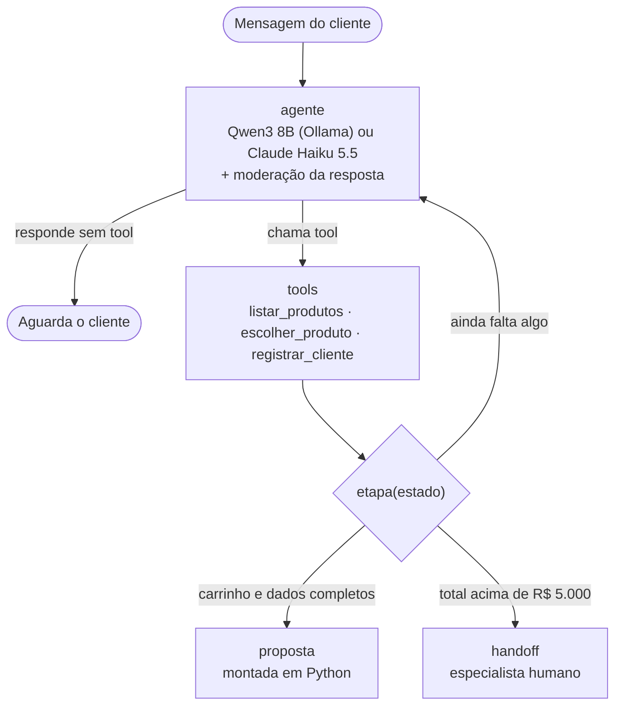

# Chatbot de vendas — Marketplace

Assistente que conversa com o cliente, recomenda eletrônicos do catálogo, coleta nome, e-mail e telefone e gera uma proposta comercial com link de checkout. Pedidos acima de R$ 5.000 são transferidos para um especialista humano.

## Como executar

Requer Python 3.11+.

```bash
python -m venv .venv
.venv\Scripts\activate          # Linux/macOS: source .venv/bin/activate
pip install -r requirements.txt
copy .env.example .env          # Linux/macOS: cp .env.example .env
```

O bot funciona com dois modelos, escolhidos pela variável `MODELO` no `.env`:

| Modelo | Onde roda | No `.env` | Requisito |
|---|---|---|---|
| **Claude Haiku 5.5** | API da Anthropic | `MODELO=claude-haiku-5-5` e `ANTHROPIC_API_KEY` | Chave da API; não precisa de GPU |
| **Qwen3 8B** (padrão) | Local, via [Ollama](https://ollama.com/download) | `MODELO=qwen3:8b` | GPU com 8 GB de VRAM e `ollama pull qwen3:8b` |

Depois, inicie o app:

```bash
streamlit run app.py
```

O app abre em http://localhost:8501 e tem duas páginas: **Chat** e **Métricas**. No chat, o painel lateral mostra, em tempo real, a etapa da venda, o carrinho e os dados capturados. As conversas ficam salvas em `conversas.db`: recarregar a página retoma o atendimento, e "Nova conversa" começa outro (o anterior continua salvo).

O `notebook.ipynb` lê o mesmo banco e mostra o grafo do LangGraph, o histórico completo de uma conversa (com as chamadas de tools e as respostas barradas pela moderação), as métricas e os testes. No VS Code, escolha o kernel do `.venv`.

## Arquitetura



| Arquivo | Conteúdo |
|---|---|
| `bot.py` | Catálogo, estado, tools e grafo (LangGraph) |
| `prompts.py` | Prompt de sistema, com o tom das conversas de referência |
| `moderacao.py` | Guardrail de moderação: lista de palavrões e classificação pelo LLM |
| `metricas.py` | Métricas calculadas a partir do histórico de conversas no banco |
| `app.py` | Interface (Streamlit): navegação entre as páginas |
| `app_pages/chat.py` | Página de chat |
| `app_pages/painel.py` | Página de métricas |
| `notebook.ipynb` | Grafo, histórico de conversas e métricas, lidos do banco |
| `test_bot.py` | Testes das regras em código, sem LLM |
| `cenarios.py` | Conversas simuladas com o modelo de verdade, com taxa de acerto |

**Decisões principais**

- **O LLM conversa; o código decide.** A etapa da venda é calculada a partir do estado (`etapa()`), nunca declarada pelo modelo. Preço, total, limite de valor (CAP) e link de checkout ficam em Python.
- **O estado só muda por tools que validam.** E-mail e telefone são validados antes de entrar no estado; se forem inválidos, a tool devolve o erro e o bot pede o dado de novo. Nome, e-mail e telefone também têm de aparecer nas mensagens do cliente, então o modelo não consegue completar um dado que o cliente não passou (como um telefone de exemplo quando o cliente só deu o e-mail). O cliente pode informar os dados em qualquer ordem e corrigi-los depois.
- **Memória em duas camadas.** O histórico da conversa fica no checkpointer do LangGraph, gravado em SQLite (um `thread_id` por conversa, guardado no endereço da página). Carrinho e dados do cliente ficam em campos tipados do estado, não "lembrados" pelo modelo.
- **Catálogo via tool.** O bot só cita produtos, preços e características que a tool devolve. Uma categoria inexistente retorna as categorias válidas.
- **Moderação em duas etapas antes de responder.** Toda resposta do LLM passa por uma lista de palavrões (determinística, com normalização de acentos e grafias como "p0rra") e, se passar, pelo próprio LLM como classificador, que pega ofensa sem palavrão (deboche, desrespeito, conteúdo sexual). Uma resposta barrada é trocada por uma mensagem padrão, e o texto original fica guardado no histórico para auditoria. O nome do cliente também passa pela lista, porque volta ao cliente no texto da proposta, que não passa pelo LLM.

## Funcionalidades

- Recomendação a partir da necessidade do cliente, com filtro por categoria
- Coleta de nome, e-mail e telefone com validação (aceita +55, DDD, fixo e celular)
- Carrinho com vários itens, troca e remoção; quantidades fora de 0–10 são recusadas
- Proposta comercial com itens, total, parcelamento em 12x e link de checkout (fictício), refeita se o pedido mudar
- Transferência para humano quando o total passa de R$ 5.000
- Regras de comportamento no prompt (sem inventar preço, desconto ou link; foco na compra; resistência a pressão do cliente) e tratamento de recusa do modelo
- Moderação das respostas do bot (palavrão, insulto, deboche, conteúdo obsceno) e recusa de nome com palavrão
- Página de métricas, atualizada a cada 5 segundos a partir das conversas salvas (detalhes abaixo)

## Métricas

Calculadas em código a partir do histórico de conversas no banco, sem LLM, então o resultado é determinístico.

- **Taxa de proposta:** conversas que terminaram com proposta e link de checkout.
- **Transferidas para humano:** conversas com pedido acima do CAP.
- **Mensagens até a proposta:** mediana de mensagens do cliente até receber a proposta. Mede o esforço do cliente.
- **Funil de vendas:** quantas conversas chegaram a cada etapa (iniciada, produto escolhido, dados completos, proposta), o que mostra onde os clientes desistem.
- **Erros de tool:** dado inválido, produto inexistente ou quantidade fora do limite.
- **Respostas barradas:** respostas do bot que a moderação impediu de chegar ao cliente. O notebook lista o texto original de cada uma, para revisar falsos positivos.
- **Conversas com problema:** violações de regras que valem para qualquer conversa. O total da proposta tem de bater com o catálogo, nunca sai proposta acima do CAP, carrinho acima do CAP sempre gera transferência e nenhum link pode vir do modelo. Além disso, o último e-mail e telefone válidos que o cliente digitou têm de estar registrados, e nenhum dado registrado pode faltar nas mensagens dele. Nestes casos o próprio histórico dá o resultado esperado, sem cenário escrito à mão.

Cada linha da tabela de conversas abre a conversa no chat, para investigar um problema.

## Testes

Duas camadas, para separar o que é regra em código do que depende do modelo.

**Regras em código (`test_bot.py`, sem LLM).** Rodam em segundos e dão sempre o mesmo resultado. Cobrem a formatação do telefone, o registro só de dados válidos e digitados pelo cliente, as etapas da venda, a transferência acima do CAP (inclusive pela soma de itens) e a proposta (total, nome do cliente e link).

```bash
pytest
```

**Conversas simuladas (`cenarios.py`, com o modelo).** Cada cenário é uma sequência de mensagens do cliente e uma verificação do estado no fim (carrinho, dados, proposta, transferência), não do texto. O bot é o mesmo do app, com o banco em memória. Cada cenário roda várias vezes, porque o LLM não responde sempre igual. Trocando `MODELO` no `.env`, o mesmo roteiro compara modelos.

```bash
python cenarios.py 5    # 5 rodadas por cenário
```

O resultado dos cenários depende do modelo. A seção 4 do notebook roda as duas camadas e registra o resultado obtido com o Qwen3 8B, com as limitações encontradas.

## Escolha do modelo

A tarefa exige pouco do LLM: ele conversa, recomenda entre 8 produtos e chama tools. O que é crítico (preço, total, CAP, validação dos dados e proposta) está no código. Por isso um modelo pequeno basta, e o mesmo código roda com qualquer um dos dois, o que também permite comparar modelos em teste A/B.

**Qwen3 8B, local via Ollama (padrão)**

- **Cabe numa GPU de 8 GB.** Quantizado em 4 bits, o modelo ocupa cerca de 5 GB e sobra memória para um contexto de 8 mil tokens (prompt de sistema, catálogo e histórico).
- **Tool calling** maduro no Ollama e bom português. O modo "thinking" fica desligado (`reasoning=False`) para responder rápido.
- **Dados e custo:** a conversa, com nome, e-mail e telefone, não sai da máquina, e não há custo por token.

**Claude Haiku 5.5, via API da Anthropic**

- **Não precisa de GPU:** use a chave da API. É o modelo mais barato da Anthropic (US$ 0,10 por milhão de tokens de entrada e US$ 0,50 por milhão de saída).
- **Mais consistência:** tende a seguir tool calls e regras do prompt melhor que um modelo local de 8B. Roda com `effort="low"` para responder rápido.

A variável `MODELO` também aceita outro modelo do Ollama com suporte a tools ou outro modelo Claude.

## Limitações e melhorias

- **Conversas em SQLite local:** basta para uma instância do app. Com várias instâncias, trocar `SqliteSaver` por um checkpointer em Postgres.
- **Link da conversa como senha:** quem tiver o endereço com o id da conversa vê o histórico, inclusive os dados do cliente. Em produção, a conversa deve ficar presa a uma sessão autenticada.
- **Avaliação antes de publicar:** os cenários simulados cobrem captura, proposta e transferência, mas são poucos e rodam à mão. Faltam cenários de manipulação (pedido de desconto, provocação) e rodá-los automaticamente a cada mudança de prompt ou modelo, com mais rodadas por cenário.
- **Qualidade da conversa:** tom, recomendação e alucinação de produto ou característica não são medidos em código. Dá para medir com um LLM como juiz, calibrado com anotações humanas, e com avaliação do cliente (👍/👎) no fim da conversa.
- **Moderação:** cobre a saída do bot e o nome do cliente. Faltam a moderação da entrada (responder com texto fixo a ofensas e tentativas de manipulação, e transferir para humano se o cliente insistir) e um conjunto de cenários de provocação para medir a taxa de bloqueio e os falsos positivos. O classificador acrescenta cerca de 0,4 s a cada resposta, e a lista de palavrões precisa de manutenção.
- **CAP por pedido:** um cliente pode dividir uma compra grande em várias pequenas. Aplicar o limite por cliente e período.
- **Catálogo em código:** em produção, consultar uma API de catálogo com estoque e busca, que também resolve catálogos grandes.
- **Sem streaming:** a resposta aparece inteira; dá para transmitir token a token com `st.write_stream`.
- **Checkout fictício:** não há integração com pagamento.
